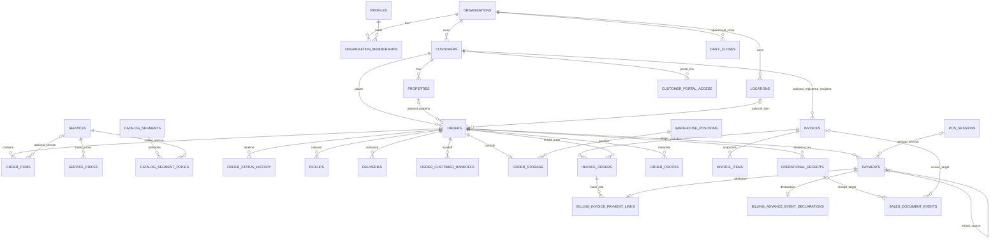
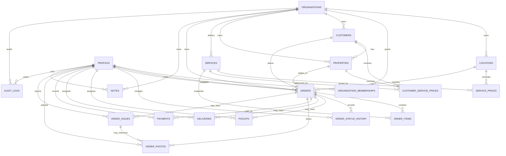

# ER Diagram

Status: Verified core FK projection

Reconciled: 2026-11-05, baseline `e511fcbf920ef8c6a05a8e8420fac853604e3880`.

This is a compact projection of confirmed migration foreign keys, not an exhaustive Supabase schema. Labels describe only the relationship shown; tenant/composite columns and many actor/organization FKs are omitted for readability. Cardinality permits zero children even where business workflows normally create them. `o|` at a parent means the child's FK may be NULL; it does not make tenant authorization optional. One-to-many notation on association tables is a projection and does not override narrower unique constraints.

## Relationship evidence and limits

| Graph edges | Migration evidence |
|---|---|
| Tenant/site/profile/membership | [Tenant foundation](../../supabase/migrations/20260727000100_app_003_tenant_foundation.sql) |
| Customer/property/order/line/service/price/history | [Customers](../../supabase/migrations/20260728000100_app_005_customers_properties.sql), [Orders](../../supabase/migrations/20260728000200_app_006_orders_workflow.sql) |
| Customer/Portal association | [Portal foundation](../../supabase/migrations/20260803000100_portal_001_customer_portal.sql); `user_id` also references Auth, omitted from graph |
| Segment/service overrides | [Segment prices](../../supabase/migrations/20260827000100_pricing_segments_001_segment_price_overrides.sql) |
| Logistics/payment/refund self-reference/photo metadata | [Logistics/payment foundation](../../supabase/migrations/20260728000300_app_007_logistics_photos_payments.sql) |
| Optional POS session/payment link | [POS foundation](../../supabase/migrations/20260827000400_pos_001_cash_register_foundation.sql) |
| Handoff/storage/position | [Handoff](../../supabase/migrations/20260913000200_order_final_handoff_001.sql), [storage](../../supabase/migrations/20260920000300_warehouse_001a_data_foundation.sql) |
| Invoice/customer/lines/order join | [Billing foundation](../../supabase/migrations/20260826000300_billing_001_invoicing_foundation.sql), [nullable recipient modes](../../supabase/migrations/20261017000200_billing_simplified_invoice_001e_recipient_snapshot_foundation.sql) |
| Fiscal payment links/declarations | [Composite role/payment links](../../supabase/migrations/20261018000200_billing_simplified_invoice_001g_b_advance_link_foundation.sql), [declarations](../../supabase/migrations/20261018000300_billing_simplified_invoice_001g_c1_advance_event_foundation.sql) |
| REC and alternative document event targets | [Sales documents](../../supabase/migrations/20260908000100_accounting_sales_documents_001.sql); each event targets exactly one of receipt/invoice, not both |
| Organization/Daily Close | [Daily Close](../../supabase/migrations/20260919000200_pos_daily_close_001_p2a.sql) |

All displayed edges are real FKs; there are no application-only edges in the current graph. The payment-link FK reaches `invoice_orders` by organization/invoice/order/role, not merely invoice ID. Payment attribution/declaration keys and issued-REC uniqueness impose stricter limits than the simplified graph; consult [Entities](../02_DOMAIN/Entities.md) and the migrations. The `payments` self-FK identifies the refund source; RPCs additionally enforce the permitted tenant/channel/state and amount boundaries.

Billing counters, REC counters, online integration records, movements, entitlements, expenses and detailed actor/tenant FKs are deliberately omitted from this central diagram, not declared absent. Snapshot JSON contents, warehouse presentation, derived balances and Accounting registry aggregation are logical/application data relationships; they must not be read as extra SQL FKs. Private Storage paths do not establish a relational FK to Storage objects. Historical generic `NOTES`, `ORDER_ISSUES`, `AUDIT_LOGS` and `CUSTOMER_SERVICE_PRICES` are not included without migration evidence. [Database Design](Database_Design.md) retains authorization limitations; [Billing Event Contract](../04_ARCHITECTURE/Billing_Event_Contract_001.md) retains fiscal gates.

## Historical original — 2026-07-28

The complete original is preserved verbatim below. Proposed entities, old mission labels and obsolete payment/Portal descriptions are dated design evidence, not current instructions. The reconciliation above takes precedence only for its verified scope.

Original 2026-07-28 document — historical snapshot

# ER Diagram

Status: Active

Version: 0.1

Last Updated: 2026-07-28

Current Mission: APP-007

---

## Purpose

Show the MVP entity relationship model for APP-002.

---

## Contents

Diagram notes:

- `organizations` is the tenant boundary.
- Some child tables inherit tenant access through `orders`.
- `notes` uses scoped entity references and must still carry `organization_id`.
- APP-006 implements `services`, `service_prices`, `orders`, `order_items` and `order_status_history`.
- APP-007 implements `pickups`, `deliveries`, `payments` and `order_photos`.
- Issue, note and audit-log operational tables remain future scope.
- The diagram omits detailed fields; full field requirements live in Domain Model, Entities and Database Design.

